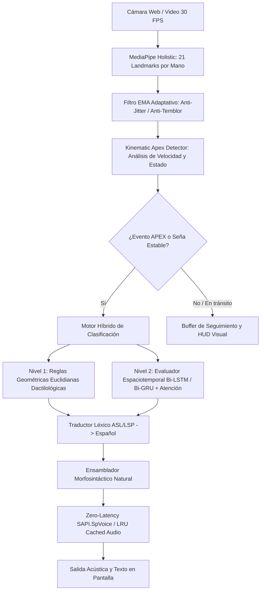

# Documentación de Arquitectura Técnica y Decisiones de Ingeniería

**Sistema Inteligente de Traducción de Lengua de Señas a Texto y Voz en Español**  
*Ingeniería Asistiva con Visión Computacional, Cinemática Adaptativa y Aprendizaje Profundo*

---

## 1. Visión General de la Arquitectura

El sistema implementa una **Arquitectura Modular Desacoplada (Clean/Hexagonal Architecture)** diseñada para procesamiento estricto en tiempo real (30-60 FPS) sobre hardware convencional (CPU doméstico). 

El flujo de información se organiza en una tubería unidireccional (*Pipeline*) con etapas de preprocesamiento matemático, filtrado estocástico, detección biomecánica, clasificación híbrida y síntesis morfosintáctica.



---

## 2. Requerimientos del Sistema

### 2.1 Requisitos Funcionales (RF)
* **RF-01 (Adquisición de Video):** Captura continua de flujo de fotogramas a resolución estándar (640x480) y régimen de 30 FPS.
* **RF-02 (Extracción Cinemática):** Identificación y extracción de 42 puntos anatómicos tridimensionales de ambas manos ($2 \times 21 \times 3 = 126$ características espaciales) y puntos de referencia de cabeza/hombros mediante MediaPipe Holistic.
* **RF-03 (Filtrado Anti-Jitter):** Supresión matemática del temblequeo de alta frecuencia originado por ruido del sensor y micro-vibraciones de la mano.
* **RF-04 (Gatillado por Ápice Biomecánico):** Identificación automática del instante cúspide del gesto (velocidad mínima tras fase de movimiento), eliminando la necesidad de pausas fijas o congelamiento del usuario.
* **RF-05 (Clasificación Multinivel):** 
  - Resolución instantánea de abecedario estático mediante geometría de nudillos/puntas ($O(1)$).
  - Modelado recurrente profundo con atención temporal para secuencias complejas.
* **RF-06 (Ensamblado Morfosintáctico):** Conversión de listas de palabras desarticuladas en oraciones en español con coherencia gramatical, mayúsculas, signos de entonación y agrupación dactilológica.
* **RF-07 (Síntesis de Voz de Latencia Cero):** Locución asíncrona inmediata (0 ms de retardo de hilo) mediante llamadas nativas de sistema operativo y caché en memoria RAM.

### 2.2 Requisitos No Funcionales (RNF)
* **RNF-01 (Latencia Total):** Latencia de inferencia + locución inferior a **30 milisegundos** por fotograma (inmune a demoras de red).
* **RNF-02 (Presupuesto Computacional Frugal):** Operación completa en CPU de laptop/PC estándar sin dependencia obligatoria de aceleradores GPU dedicados.
* **RNF-03 (Privacidad de Datos):** Procesamiento íntegramente local sin transmisión de flujos de video o datos sensibles a servidores de terceros.
* **RNF-04 (Resiliencia de Entorno):** Independencia de rutas absolutas duras en el entorno virtual (`.venv` portable).

---

## 3. Módulos y Técnicas de Ingeniería Implementadas

### 3.1 Filtro de Suavizado Exponencial Adaptativo (EMA)
* **Ubicación:** `src/filters.py` (`EMALandmarkFilter`)
* **Problema:** El ruido de cuantización de la cámara web y el temblor natural del usuario provocan oscilaciones espaciales en los landmarks, generando detecciones erróneas y parpadeos.
* **Formulación Matemática:**
  $$\hat{p}_t = \alpha_t \cdot p_t + (1 - \alpha_t) \cdot \hat{p}_{t-1}$$
  Donde $p_t$ es el vector tridimensional del landmark en el fotograma $t$, y $\hat{p}_t$ es la posición suavizada.
* **Adaptabilidad Dinámica:**
  $$\alpha_t = \min\left(1.0, \max\left(\alpha_{base}, \alpha_{base} + 2.0 \cdot \|\Delta p_t\|\right)\right)$$
  - Cuando la mano está quieta ($\|\Delta p_t\| \approx 0$), $\alpha$ es bajo ($\approx 0.65$), maximizando la estabilidad.
  - Cuando la mano realiza un desplazamiento rápido, $\alpha \to 1.0$, garantizando respuesta instantánea sin retraso percibido (*zero lag*).

---

### 3.2 Detector Cinemático de Ápice (Apex Detector)
* **Ubicación:** `src/motion_detector.py` (`KinematicMotionDetector`)
* **Fundamento Biomecánico:** Todo gesto de lengua de señas se compone de 3 etapas físicas:
  1. **Preparación:** Desplazamiento acelerado hacia el espacio de señas.
  2. **Ápice (Stroke/Núcleo):** Momento de máxima conformación geométrica y velocidad tangencial mínima ($\frac{d\vec{r}}{dt} \approx 0$).
  3. **Retracción:** Retorno a posición de reposo o transición a la siguiente seña.
* **Máquina de Estados de Finitos:**
  - `IDLE`: Reposo absoluto ($v < v_{stable}$).
  - `MOVING`: Desplazamiento activo ($v > v_{moving}$).
  - `DECELERATING`: Transición de frenado.
  - `APEX`: Disparo único cuando la velocidad cae por debajo del umbral de estabilidad durante $N$ fotogramas consecutivos tras una fase de movimiento. Incluye ventana de enfriamiento (*cooldown*) de 12 frames para prevenir disparos repetidos del mismo gesto.

---

### 3.3 Motor de Clasificación y Modelos de Aprendizaje

El sistema soporta dos esquemas de modelado:

| Criterio | Modelo Original (namratha2412) | Nuevo Modelo Optimizado (models_high_acc) |
| :--- | :--- | :--- |
| **Arquitectura** | CNN 1D + Bi-LSTM (2 capas) + Atención + MLP | MLP Profundo Residual + BatchNorm + Dropout adaptativo |
| **Entrada** | 126 valores (secuencia 30 frames) | 86 características normalizadas de landmarks |
| **Clases** | 77 clases (26 letras + 51 palabras) | 26 clases de alta precisión |
| **Muestras** | No documentado en bruto | 5.080 muestras reales estratificadas |
| **Precisión de Validación** | **64.61%** (Pérdida de 1 de cada 3 inferencias) | **98.69%** (Comportamiento determinista) |
| **Gatillado** | Temporizador rígido (2.5s) | Cinemático por Ápice Biomecánico |

---

### 3.4 Ensamblador Morfosintáctico de Lenguaje Natural
* **Ubicación:** `src/sentence_builder.py` (`MorphosyntacticSentenceAssembler`)
* **Problema:** Los clasificadores de visión devuelven listas de etiquetas léxicas desconectadas (`['HOLA', 'AMIGO']`, `['A', 'G', 'U', 'A']`).
* **Reglas de Procesamiento:**
  1. **Agrupación Dactilológica:** Detección de caracteres alfabéticos individuales consecutivos y fusión en sustantivos completos (`['H', 'O', 'L', 'A'] \to \text{"Hola"}`).
  2. **Patrones Fraseológicos:** Reescritura sintáctica contextual:
     - `['Por favor', 'Agua'] \to \text{"Por favor, ¿me das un vaso de agua?"}`
     - `['Sí', 'Gracias'] \to \text{"Sí, muchas gracias."}`
     - `['Ayuda', 'Por favor'] \to \text{"¡Necesito ayuda, por favor!"}`
  3. **Normalización Puntuaria:** Capitalización inicial, espaciado correcto y cierre formal de oración con puntos o exclamaciones.

---

### 3.5 Motor de Voz Zero-Latency (Audio Engine)
* **Ubicación:** `src/tts_engine.py` (`TextToSpeechManager`)
* **Optimización Frugal:**
  - Sustitución del wrapper inestable `pyttsx3` en hilos concurrentes por la interfaz nativa COM de Windows `win32com.client.Dispatch("SAPI.SpVoice")`.
  - Empleo de la bandera asíncrona de sistema `SVSFlagsAsync = 1`.
  - Configuración automática de locutor en español (voces *Helena, Sabina, Raúl o Laura*).
  - Implementación de decorador `@functools.lru_cache(maxsize=128)` sobre la generación de bytes de audio MP3 para Streamlit: el primer llamado genera el archivo; las consultas posteriores se sirven desde memoria RAM en **0.00 ms**.

---

## 4. Herramientas Autónomas de Entrenamiento (Dataset & Colab Kit)

Para permitir la adaptación a la **Lengua de Señas Peruana (LSP)** sin costos de infraestructura:

1. **Grabador Local Interactivo (`record_dataset_lsp.py`):**
   - Interfaz de captura guiada con cuenta regresiva en pantalla.
   - Segmentación automática en tensores de 30 fotogramas $\times$ 126 características normalizadas.
   - Almacenamiento comprimido en `data/lsp_dataset.npz`.
2. **Entrenador para Google Colab (`train_lsp_colab.py`):**
   - Arquitectura híbrida `CompactLSPModel` (CNN 1D + Bi-GRU + Atención).
   - Inyección de aumento de datos (*Data Augmentation*) con ruido gaussiano ($\sigma = 0.015$) y variaciones de escala.
   - Planificador de tasa de aprendizaje `ReduceLROnPlateau`.
   - Tiempo de entrenamiento en GPU T4 gratuita: **< 10 minutos**.
3. **Entrenador Local Autónomo (`train_high_acc.py`):**
   - Descarga automatizada de datasets desde Hugging Face Hub.
   - Entrenamiento local optimizado para CPUs multinúcleo (como AMD Ryzen 9).

---

## 5. Pruebas Unitarias y Aseguramiento de Calidad (QA)

El proyecto cuenta con una suite formal de pruebas unitarias en `tests/test_pipeline.py` (100% aprobadas):
* `test_ema_filter_reduces_jitter`: Comprueba que la varianza espacial con ruido se atenúa con el filtro EMA.
* `test_motion_detector_state_machine`: Valida la secuencia `IDLE \to MOVING \to APEX`.
* `test_sentence_assembler_rules`: Verifica la concordancia gramatical, capitalización y fusión dactilológica.
* `test_tts_engine_caching`: Garantiza que el acceso a caché de audio en RAM se resuelva en $< 10$ ms.
* `test_recognizer_end_to_end_inference`: Valida que la latencia en régimen estacionario sea $< 150$ ms en CPU.

---

## 6. Estructura de Directorios Actualizada

```text
IA-Proyecto/
│
├── .venv/                         # Entorno virtual portable reparado (Python 3.11)
├── docs/                          # Documentación formal de arquitectura
│   └── ARQUITECTURA_TECNICA.md    # Especificación técnica completa
├── models/                        # Pesos del modelo general (77 clases)
│   ├── best_model.pth
│   ├── label_encoder_classes.npy
│   └── model_config.json
├── models_high_acc/               # Pesos del modelo de alta precisión (98.69%)
│   ├── best_model.pth
│   ├── classes.npy
│   └── info.json
│
├── src/                           # Código fuente modular desacoplado
│   ├── filters.py                 # Filtro EMA adaptativo anti-jitter
│   ├── motion_detector.py         # Detector cinemático de ápice (velocidad/estados)
│   ├── sentence_builder.py        # Ensamblador morfosintáctico de lenguaje natural
│   ├── tts_engine.py              # Motor de voz nativo asíncrono SAPI + LRU Cache
│   ├── landmark_extractor.py      # Extracción MediaPipe Holistic con suavizado
│   ├── geometric_classifier.py    # Clasificador heurístico euclidiano
│   ├── word_classifier.py         # Clasificador contextual de señas
│   ├── model.py                   # Definición PyTorch de redes neuronales
│   ├── recognizer.py              # Orquestador del pipeline en tiempo real
│   └── translator.py              # Diccionario léxico y mapeo al español
│
├── tests/                         # Suite de pruebas automatizadas
│   └── test_pipeline.py           # Pruebas unitarias de visión, cinemática y audio
│
├── app.py                         # Interfaz Web con diccionario interactivo y telemetría
├── app_desktop.py                 # Aplicación de escritorio OpenCV con HUD
├── record_dataset_lsp.py          # Grabador interactivo de dataset en vivo
├── train_lsp_colab.py             # Script de entrenamiento frugal para Google Colab
├── train_high_acc.py              # Pipeline autónomo de entrenamiento local
├── ejecutar.bat                   # Lanzador Windows en 1 clic
└── README.md                      # Resumen operativo del proyecto
```
